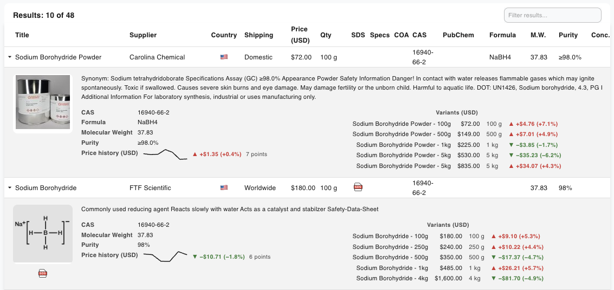
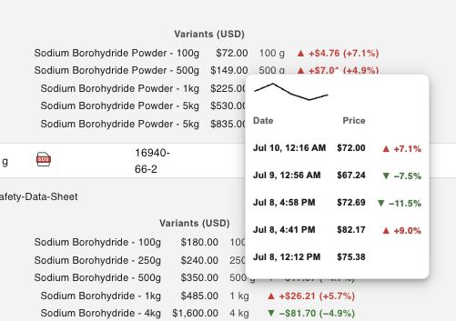

ChemPal quietly remembers the prices it sees, so over time you can tell whether a
product is getting cheaper or more expensive — and time your purchase accordingly.

## How it works

- **It's automatic.** Every time a product shows up in your search results,
  ChemPal records its price (converted to USD for a consistent baseline).
- **It only records changes.** A new data point is saved when the price actually
  differs from the last one, so the history stays meaningful rather than a flat
  line of identical values.
- **It's on by default.** No setup needed.

## Where you see it

Open a product's [detail panel](Results-Table#product-details) (click the **▸
arrow** on its row). If ChemPal has seen the product more than once, you'll find a
**Price history** section showing:

- A **sparkline** — a tiny line chart of the price over time.
- A **trend indicator** — an arrow and percentage. **Rising prices show in red**,
  **falling prices in green**.
- A **point count** (e.g. "5 points") telling you how much history exists.

If tracking is on but ChemPal has only seen the product once, it shows **"No
history yet"** — check back after future searches.

Products with **variants** (multiple sizes) keep a separate history per variant,
so you can see which size is trending up or down.

Variant price trend history available on hover.

## Price alerts

Want to know when a price drops? Right-click a product in the results and choose
**Enable price reduction alerts**. The option is greyed out when ChemPal can't
check that supplier (see [Supported Suppliers](Supported-Suppliers#price-alerts)).

- **A whole product is watched**, including all its sizes.
- **ChemPal checks in the background**, every 12 hours by default, and only while
  your browser is open. A check that was missed runs the next time the browser starts.
- **A drop is logged** in the product's price history and shows a notification.
  Notifications are optional: ChemPal asks for the permission when you enable your
  first alert, and if you decline, drops still show on the toolbar icon and in
  **Settings → Price Alerts**.
- **The toolbar icon flashes green and amber** for a few seconds, then shows how many
  products dropped, for example **↓2**. It clears when you open **Settings → Price
  Alerts** or click the notification. Search progress takes priority while a search
  is running. Pin ChemPal to your toolbar to see it.
- **Prices are compared in the supplier's own currency**, so exchange-rate changes
  never trigger an alert.

Review your alerts in **Settings → Price Alerts**, where you can remove one, several,
or all of them. Change how often products are checked, and how big a drop must be,
in **Settings → Advanced** (see [Settings](Settings#advanced)).

## Turning it off or clearing it

Everything lives under **Settings → Price History**:

- **"Track price history"** — the master switch. Turn it off to stop recording.
- **"Max price points per product"** — cap how many data points to keep per product
  (`0` = unlimited).
- **"Clear price history"** — wipe all recorded history. This is separate from
  [clearing the cache](Caching) — clearing the cache does **not** erase your price
  history, and vice-versa.

Your watchlist is stored locally in your browser too. All of this data stays **on your device** — see [Privacy](Privacy).

---

**Next:** [Search History →](Search-History)
